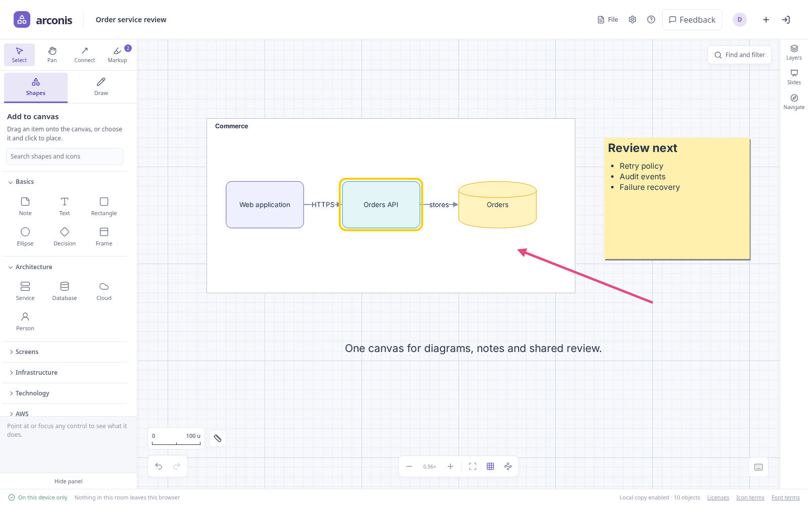

# Arconis

Arconis is an open-source shared canvas for diagrams, notes, drawings and presentations.
Use it to explain a system, work through ideas with other people, or turn a working canvas
into a presentation. Start in your browser as a guest; an account is optional.

**[Open Arconis](https://arconis.ahara.io)** · [Getting started](docs/getting-started.md) ·
[User guides](docs/README.md) · [What's changed](CHANGELOG.md)

## Keep the work in one place

A diagram usually needs more than boxes and arrows: the questions beside it, a sketch of an
alternative, a code example, and a way to walk other people through the result. Arconis keeps
these together in one editable document. You can move from a rough discussion to an organized
diagram and a presentation while continuing to work on the same content.

### Explain systems and connections

Build flowcharts and architecture diagrams with shapes, labeled connectors and searchable
technology icons, including AWS, Azure and Google Cloud. Use frames to organize related
components, arrange a selection, or grow ideas into topic trees with keyboard shortcuts.
Tags, tasks, cross-references and comments keep decisions attached to the objects they concern.

[Explore canvas editing](docs/editing.md) · [Build a topic tree](docs/editing.md#topics-and-depth)

### Sketch, annotate and write

Draw editable ink alongside shapes and pictures, with freehand brushes, geometric paths, fills
and gradients. Switch to **Markup** for review arrows, highlights and outlines that can be
hidden or cleared together. Write Markdown, code and equations directly in labels and notes.

[Drawing and markup](docs/drawing.md) · [Text and formatting](docs/text.md)

### Present the canvas

Place slides around the areas you want to show, organize them into decks, and present with
shared speaker notes and reusable template content. Slides frame the existing canvas;
editing the diagram updates what you present.

[Create a presentation](docs/slides.md)

### Work at a meaningful scale

Zoom from an overview into detail. Set a drawing scale with Paper, Electronics, Product, House,
Site or Geography presets, or define your own distance and unit. The scale bar, measurement
tool, geometry fields and grid use that calibration as you zoom.

[Scale, units and measurement](docs/editing.md#scale-units-and-measurement)

### Work together, or on your own

Invite people by room link, see their cursors, follow someone's view and discuss objects in
comments. Each person keeps their own selection and view. Local editing continues when the
connection drops, and completed edits merge when collaboration returns. Choose a device-only
room when you want to work without live collaboration.

[Rooms and collaboration](docs/collaboration.md)

### Keep editable copies and reuse your work

Your browser retains a local copy. Export an editable `.arconis` document or a PNG with an
editable canvas embedded in it. Optional accounts add private saved copies across devices,
five recent saved versions and a library of your own reusable layouts.

[Files and pictures](docs/files.md) · [Accounts and saved work](docs/accounts.md)

### Bring an assistant into the room

Connect a compatible remote MCP client, such as Claude or ChatGPT, through your Arconis account.
Ask it to read or change an ordinary room you have open. Its diagrams, text and drawings remain
editable canvas objects, and you can keep working alongside it.

[Connect an assistant](docs/agents.md)

## Start your first canvas

1. Open **[Arconis](https://arconis.ahara.io)**, enter a display name and choose **Create a room**.
2. Press **N** and click to add a note, or choose a shape from **Shapes**. Double-click an
   object to edit its text; press **Ctrl/Command Enter** to finish.
3. Choose **Share room** to invite someone. Keep your canvas open while a new participant joins.
4. Choose **File → Export document** to keep a portable copy, or sign in and choose
   **Save to my account** for access on another device.

For a walkthrough, see [your first shared canvas](docs/getting-started.md). In the app, open
**Help** for the guides or **Take the tour** for an introduction to the workspace.
**Ctrl/Command K** opens the command palette and shortcuts.

## Sharing and keeping your work

A room link lets people join and edit; it is **not a backup**. A new device needs someone with
the canvas online, a portable file, or an account-saved copy. Clearing browser storage removes
that browser's local copy.

Ordinary rooms use link-based access. Password rooms also require a room password, but there
are no read-only roles or account-based room memberships. Changing a password does not revoke
access from someone already holding the room key. Use rooms for non-sensitive collaboration,
and read [room access and recovery](docs/collaboration.md) before relying on a sharing setup.
Portable exports are readable copies outside room-password protection.

## Find a guide

| I want to…                                               | Guide                                                                |
| -------------------------------------------------------- | -------------------------------------------------------------------- |
| Make my first canvas and invite someone                  | [Getting started](docs/getting-started.md)                           |
| Arrange shapes, connect objects or build a mind map      | [Using the canvas](docs/editing.md)                                  |
| Set units, measure a distance or choose grid spacing     | [Scale and measurement](docs/editing.md#scale-units-and-measurement) |
| Sketch artwork or annotate a review                      | [Drawing and markup](docs/drawing.md)                                |
| Write Markdown, code or equations                        | [Text and formatting](docs/text.md)                                  |
| Turn the canvas into a deck                              | [Slides and presentations](docs/slides.md)                           |
| Share a room, use a password or work offline             | [Rooms and collaboration](docs/collaboration.md)                     |
| Save across devices, recover a version or reuse a layout | [Accounts](docs/accounts.md)                                         |
| Import, export or add pictures                           | [Files and pictures](docs/files.md)                                  |
| Work with an assistant                                   | [Assistants and MCP](docs/agents.md)                                 |

## Feedback and contributions

Use **Feedback** in the application to describe a problem or confusing interaction. Screenshots
are optional; the form explains what accompanies a report. See the
[feedback guide](docs/editing.md#send-usability-feedback) for details.

To work on Arconis itself, start with [local development](docs/development.md), including setup
and required checks, and the [repository rules](AGENTS.md). The
[documentation index](docs/README.md#contributor-and-operator-reference) links to architecture,
deployment and decision records. [Product scope](docs/product.md) describes current capabilities;
the [backlog](docs/backlog.md) describes future work, including PDF/PPTX deck export.

## License

MIT; see [LICENSE](LICENSE). The deployed site lists dependency licenses at `/licenses.txt`.
AWS, Azure and Google Cloud icons have [their own terms](frontend/public/third-party-icons.txt).
