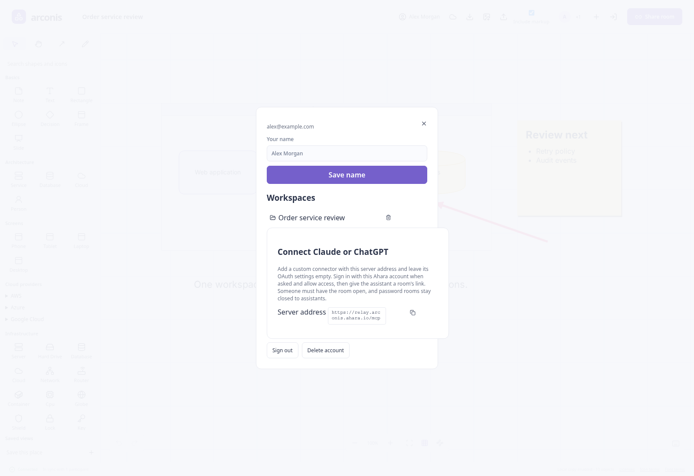

# Accounts and saved workspaces

An account adds private saved copies and assistant connections. Rooms remain usable by guests;
signing in does not change who can join an ordinary room by its link.

## Create an account or sign in

1. Choose **Sign in** on the welcome screen or workspace header.
2. Choose **Sign in or create an account** to open Ahara's sign-in page at `auth.ahara.io`.
3. For a new account, follow the sign-up prompts and enter the verification code sent to your email.
4. Return to Arconis. Open the account panel, enter **Your name**, and choose **Save name**.

Your account begins with your email as its name. The saved display name is used in rooms.
The sign-in service handles password-reset prompts; the Arconis panel holds no password form.

## Save a room

1. Open the room and sign in.
2. Choose the cloud button labelled **Save to my account** in the header.
3. After the initial save, the same button becomes **Save now**. Edits continue to be saved
   after activity settles; choose Save now when you want to save immediately.

The saved workspace includes the shared document, markup and picture data needed to restore it.
The **Include markup** export checkbox has no effect on account saving.
Before storing an existing saved workspace, Arconis merges a newer saved copy, preserving edits
made from another device rather than replacing that device's work.

Saving belongs to your account. Other people in the live room do not automatically receive
their own saved copy. They can choose to save the room to their accounts separately.

## Open a saved workspace

Open the account panel on the welcome screen or from the header. Under **Workspaces**, choose
the saved workspace's name. The copy opens in its room, even when no other participant is online.
If that room is already open, its saved contents merge into the current document.

Opening a saved workspace retains the room's identity. Joining participants still use that room's
link, and a separate **Import document** operation adds portable file contents into a destination
room. [Files and pictures](files.md) compares these paths.

## Password rooms and password resets

| Copy                | Protection                                                             |
| ------------------- | ---------------------------------------------------------------------- |
| Ordinary saved room | Stored as an ordinary account copy, readable by the service.           |
| Saved password room | Sealed in the browser under its room key; listed as **Password room**. |

Opening a saved password room asks for its room password. An account password reset preserves
all saved workspaces because the copies are not encrypted under that account password. It does
not recover a forgotten room password.

## Delete a saved copy or account

The delete button beside a saved workspace removes that account's saved copy. It is separate
from deleting objects on the canvas or clearing another browser's local copy.

**Sign out** ends account access in this browser. **Delete account** asks for confirmation and
removes the account and its saved workspaces. Export any portable copies you want before
deleting saved data.

## When saving or signing in fails

The account panel displays sign-in failures; complete the sign-in or email verification it
requests, then retry. Save failures are shown in the workspace's message area. Check the account
connection and use **Save now** again; a local room copy and a portable export are independent
ways to retain work.

For assistant setup, see [assistants and MCP](agents.md).
