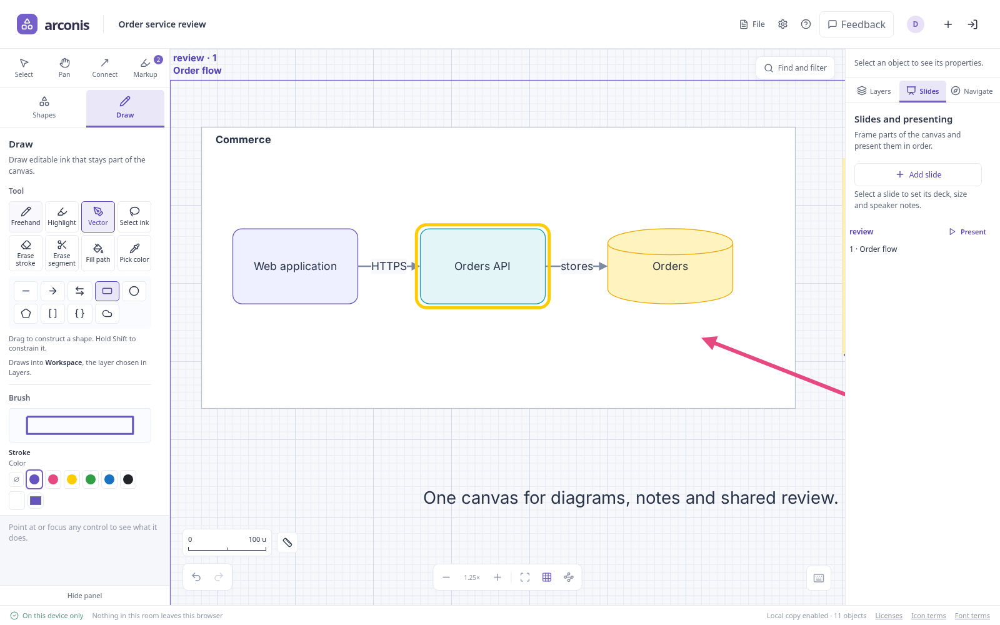

# Drawing and markup

Markup is shared, editable notation above the workspace. A Drawing is a workspace object that
holds editable ink. Use markup for annotations and promote a sketch when it should move and
connect as part of the diagram.

## Choose an instrument

Press **P** or choose **Draw** in the left rail. Each instrument has an icon and guidance for its
gesture. The panel shows the settings that apply to that instrument.

The drag radial's **Draw** arc offers the same instruments. While drawing, workspace connection
points, connected-copy controls and resize handles stay hidden. Lassoed ink retains its own
transform handles.

| Instrument       | Use                                                                       |
| ---------------- | ------------------------------------------------------------------------- |
| Pen              | Draw opaque freehand strokes or shapes.                                   |
| Highlighter      | Draw translucent strokes over text and objects.                           |
| Highlight object | Click a workspace object to toggle an attached outline.                   |
| Lasso            | Select whole ink strokes and shapes for editing.                          |
| Eraser           | Remove every whole stroke touched by a click or sweep.                    |
| Precision eraser | Cut away the parts of strokes crossed by the eraser.                      |
| Fill             | Click a closed path to apply the current ink color and gradient settings. |
| Eyedropper       | Pick a drawing or object's color into the current ink color.              |

Pen and Highlighter remember separate colors and widths. Choose a width preset or enter a
finer value in **Width**. Use a swatch, a recent color or the color picker. Open **Saved brushes**
to see a stroke preview, instrument, shape and width for each brush. Click its preview to use
it, or its **Save** button to replace it with the current settings. Brush preferences and saved
brushes are stored in your browser.

## Draw quick shapes

Choose a **Stroke shape**, then draw with Pen or Highlighter:

| Geometry                       | Gesture                                                                |
| ------------------------------ | ---------------------------------------------------------------------- |
| Freehand                       | Drag the stroke.                                                       |
| Line, Arrow, Double arrow      | Drag from the starting end toward the finishing end.                   |
| Box, Circle                    | Drag across opposite corners of the shape's bounds.                    |
| Polygon                        | Click corners; click near the first corner or press Enter to close it. |
| Bracket, Brace, Revision cloud | Drag across the bounds.                                                |

Hold **Shift** to constrain a box or ellipse to equal sides, or a line or arrow to a fixed
direction. **Escape** cancels an unfinished polygon. Completed gestures are shared and undoable.

## Highlight an object

Choose **Highlight object**, then click a note, shape, picture or Drawing. The outline follows
its target when it moves, resizes or rotates, while leaving the target's appearance unchanged.
Click the object again to remove the outline. Deleting the target removes its outline; Undo
restores both.

Freehand markup stays at the coordinates where you drew it. Use an attached outline when the
annotation should follow an object.

## Select, transform and erase ink

1. Choose **Lasso** and drag around strokes or shapes. Hold **Shift** to add to the selection.
2. Drag the selection to move it, or use its corner and top handles to scale and rotate it.
3. Choose an ink color and **Apply ink color to strokes** in **Selected strokes**, or use Duplicate
   and Delete as for other items. The color action appears only when ink strokes are selected.

Ordinary workspace selection reaches the diagram beneath markup. Inside an open Drawing,
Lasso and erasers work on that Drawing's contents. Outside it, they work on markup.

**Eraser** removes whole strokes, including when a fast sweep crosses between pointer samples.
**Precision eraser** leaves the surviving pieces editable. Undo reverses a completed eraser gesture.
**Delete all annotations**, under **Canvas annotations**, removes the canvas's annotations for
everyone in one undoable operation, retaining workspace objects and promoted Drawings. This
canvas-wide action is available outside an open Drawing; it is disabled when there are no annotations.

## Fill a closed path

Open **Fill and gradient** in the palette. **Shape fill** sets the interior for newly drawn
closed shapes; **No shape fill** leaves an outline. The pen's ink color controls the outline.

For an existing shape, choose the ink color, select **Fill** and click inside the closed path.
Alternatively, lasso it and choose **Fill selection**. These two actions use the current ink
color for the interior. For a freehand loop, select it and use **Close or open selected path**
to make it eligible for filling.

Choose **Gradient color** for a two-color fill, or **Solid fill** to use one color. Set
**Gradient angle**, or select a filled gradient path and drag its direction handle. Hold Shift
while dragging to snap the direction. Moving or transforming a filled Drawing preserves its
editable paint settings.

## Promote markup into a Drawing

1. Lasso the strokes to keep together.
2. Choose **Make Drawing**. Arconis creates a holder around the painted ink and opens it for editing.
3. Add more strokes with the same palette, then choose **Finish Drawing** or press Escape.
4. Select the Drawing to name, move, resize, rotate, connect or comment on it.

Promotion preserves the paths and paint rather than flattening them into a picture. A Drawing
moves with its contents and can sit inside a frame or slide. Its boundary clips the displayed ink;
paths outside the boundary remain in the document.

**New Drawing** creates a blank Drawing near the center of the view and opens it for editing.
Double-click an existing Drawing to edit it again. **Fit bounds to drawing** refits an upright
boundary around all its painted contents, including wide strokes, and removes unused space.

**Return to markup** releases the contents and removes the holder. Connectors attached to that
holder are removed with it. Undo restores the Drawing and its relationships.

## Show, share and export

- **Show annotations**, under **Canvas annotations**, changes only your view. Presentations use
  the **Show markup** control, and the [layer browser](editing.md#layers) the eye on its
  **Markup** row, for the same setting. Markup always draws above every layer and belongs to
  none, whichever layer is chosen. It does not hide markup
  from other participants or remove it from the document.
- **Include markup** controls document and PNG exports independently of what you currently see.
  A clean PNG excludes markup from its pixels and embedded editable copy.
- Promoted Drawings remain workspace content when markup is hidden, cleared or excluded from export.
- Local persistence and account saves retain the complete document, including markup.

See [files and pictures](files.md) for export scope and [assistants and MCP](agents.md) for
authoring the same paths through the canvas language.

## Limitations

Fill operates on one closed path; it does not discover regions formed by crossing separate
strokes. Lasso selects whole paths, and precision erasing edits stroke geometry rather than
pixels. Dense collections of long paths can make editing and export noticeably slower.
