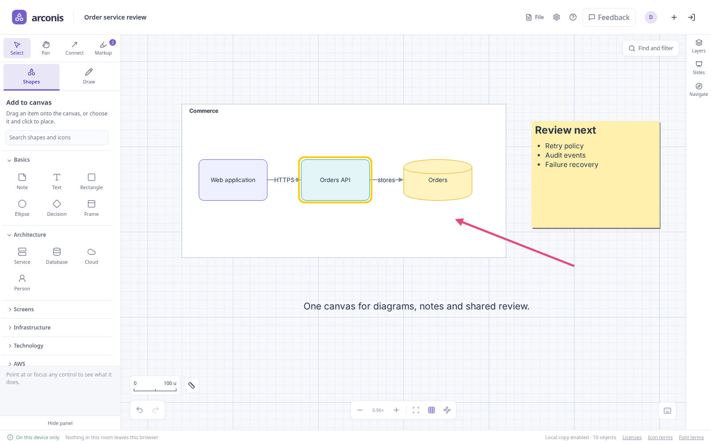

# Your first shared canvas

Arconis combines diagrams, sticky notes, Markdown, drawings and slides in one room. You can
work as a guest; an account adds saved workspaces and assistant connections.

This walkthrough makes a small diagram, adds review annotations and keeps an editable copy.
You can also open **Help → Take the tour** for an introduction to the controls in your current room.

## Start a room

1. Open [Arconis](https://arconis.ahara.io).
2. Enter a display name and choose **Create a room**. Signed-in participants use their account name.
3. Change **Canvas title** in the header to name the workspace.
4. Choose **Share room**, then **Copy room link** to invite someone. Keep this tab open while
   a new participant joins, so they can receive the canvas.

**Room options** on the welcome screen holds **Create a password room** and **Work on this
device only**.
[Rooms and collaboration](collaboration.md) explains how those choices affect sharing and storage.

From an open canvas, choose **File → New canvas** to start a separate document. The current
canvas stays saved on this device. **File → Join room…** opens another room by link or code;
**File → Back to my canvases** returns to the home screen.

## Build a small diagram

1. Press **N** and click the canvas to add a note. Type an idea and press **Ctrl/Command Enter**
   to finish. Enter by itself inserts a line.
2. Open **Shapes** in the left rail and choose **Rectangle**, then click the canvas. Double-click
   the rectangle to name it, and finish the edit.
3. Choose **Connector: click two objects** and click the note followed by the rectangle.
4. Press **V** to select. Drag either object; the connector stays attached.
5. Select an object to see its properties in the right dock: **Design** for type, text and appearance,
   **Arrange** for layers and relationships, and **Data** for tags and named values.
   Right-click it for the menu, or right-drag to pan. **Settings → Enable
   context wheel** replaces right-drag panning with a ring of commands. On narrow screens,
   **Hide panel** folds the left panel to give the canvas room.

You can also drag stencils directly from the rail. Search the rail to find architecture icons.
The right dock's tabs open **Layers**, **Slides** to create and present decks, and **Navigate**
for jump points, topic outlines, tags and history.
The [canvas guide](editing.md) covers selection, containers, connectors and keyboard navigation.

## Mark it up

Press **M**. A small bar opens over the canvas; choose **Marker** and drag over the diagram. The
marks are temporary annotations above the workspace, shared with the room. Choose **Outline
object** and click an object to attach an outline. **Clear** removes every annotation, and
**Done** puts Markup away.

To keep a mark, choose **Select annotations**, drag around it, and choose **Move to content
layer** in the property panel. To draw artwork that belongs to the canvas, press **P** for
**Draw**. The [drawing guide](drawing.md) covers brushes, shapes, erasing, fills, gradients and
transfers.

## Keep a copy

Your browser retains the room locally. For a portable copy, open **File** in the header and
choose **Export document**.
An account's **Save to my account** button keeps a workspace available on other devices.

A room link is an invitation, not a backup. Another device needs an online participant holding
the canvas, an account-saved copy or a portable file. Clearing browser storage removes the
local copy, so export or save work you want to retain independently.

**Export PNG** exports the selection, or the whole canvas when nothing is selected, and includes
an editable copy. **Include markup**, in the same menu, controls whether annotations appear in document and PNG
exports. [Files and pictures](files.md) explains import, export and storage choices.

## Navigate and measure

Right-drag, or hold Space and drag, to pan. Use the zoom controls at the bottom to zoom in, zoom out or fit the
canvas; `1×` is the normal view. Your view is independent of other participants' views.

For a drawing with real distances, open **Settings** in the header and, under **Scale and
units**, choose a preset or enter a custom distance and unit. Choose **Measure** among the tools
and drag between two points; the length reads on the line. The scale bar beside the zoom
controls and the grid adapt as you zoom, while the
measured distance keeps its meaning. [Scale and measurement](editing.md#scale-units-and-measurement)
explains calibration and unit-aware geometry fields.

## Get help while working

Open **Help** in the header, or press **?**, to search these guides. **Ctrl/Command K** opens the
command palette with available commands and shortcuts. Point at a control or focus it to read
its help; on touch screens, hold it. Use **Feedback** in the header to describe a problem or
an interaction that was unclear.

## Continue by task

| Task                                                         | Guide                                                           |
| ------------------------------------------------------------ | --------------------------------------------------------------- |
| Arrange objects, connect them or build a topic tree          | [Using the canvas](editing.md)                                  |
| Set drawing units, measure a distance or change grid spacing | [Scale and measurement](editing.md#scale-units-and-measurement) |
| Annotate or draw editable shapes in layers                   | [Drawing and markup](drawing.md)                                |
| Write Markdown, code or equations                            | [Text and formatting](text.md)                                  |
| Turn a canvas into a presentation                            | [Slides and presentations](slides.md)                           |
| Invite people, work offline or use a password                | [Rooms and collaboration](collaboration.md)                     |
| Save across devices or manage an account                     | [Accounts and saved workspaces](accounts.md)                    |
| Exchange documents, PNGs and pictures                        | [Files and pictures](files.md)                                  |
| Work alongside Claude or ChatGPT                             | [Assistants and MCP](agents.md)                                 |
