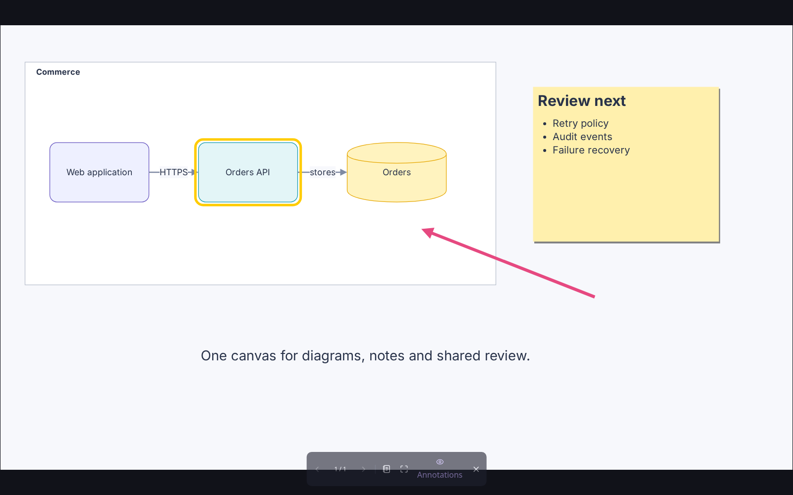

# Slides and presentations

A slide is a bounded viewport over the canvas. Slides with the same **Deck** name form a
presentation, ordered by **Slide number**. Content stays in the same workspace while you present.

Use a deck to walk through a diagram, show sections of a workshop canvas, or present the same
work you are still editing. You can keep more than one deck in a room.

## Build a deck

1. Open **Slides** in the right dock, choose **Add slide**, and click the canvas.
2. Select the slide and use the property panel's **Slide** section to set its deck and number.
3. Choose **Wide 16:9**, **Standard 4:3**, or keep a custom size. Drag its handles to resize
   while preserving proportions.
4. Add a name through **Object text**. The canvas label also shows its deck and number.
5. Add more slides. A new slide uses the selected slide's deck, otherwise the last used or an
   existing deck, and follows its highest number. It adopts that deck's slide size.

The **Slides** panel groups slides by deck, with a **Present** button beside each deck name.
Click a slide entry to fly to it.
Gaps in slide numbers are valid; matching numbers are ordered by item id.

## Put content on a slide

A slide holds nothing. Position it around content to frame that content for presenting, or
place objects over it. Moving a slide moves only the viewport, and deleting it leaves the content
it framed in place. To move a slide's content with it, put the content in a frame or group and
move both. [Using the canvas](editing.md#containers-and-groups) explains containment and grouping.

## Reuse a template

1. Create a slide in the deck and enable **Template under the deck's slides** in its properties.
   Its number becomes 0.
2. Place shared content over it: a title region, footer, logo or background drawing. Objects
   whose centre lies within the template, with what they hold, form the template. Markup is not
   repeated.
3. Open another slide in the same deck to see the template content beneath it.

Template copies are dimmed while editing and shown at full strength while presenting. Edit the
template to update the deck. Copies on other slides are read-only views of that content; clicking
one selects the slide beneath it. If slide sizes differ, the template content scales to fit.
The template itself is skipped during a presentation.

Turning off the template checkbox gives that slide a number at the end of the deck. Editable
drawings, pictures and Markdown labels work inside templates as they do elsewhere.

## Add speaker notes

Select the slide and use **Speaker notes** near the top of the property panel. Enter sends the note;
Shift Enter adds another line. These threads are the slide's speaker notes and are shared with
the room. The presenter displays their text in a notes panel. On phones and tablets, notes occupy
a bounded area below the slide; **Close speaker notes** restores the full stage.

## Present

Choose **Present** beside a deck in the Slides panel, or **Present from here** in the selected
slide's properties. The editor controls give way to the slide and its presentation bar.

| Control                         | Action                                 |
| ------------------------------- | -------------------------------------- |
| Left / Page Up / Previous slide | Go to the preceding slide.             |
| Right / Page Down / Next slide  | Go to the following slide.             |
| Speaker notes                   | Show or hide the notes panel.          |
| Full screen                     | Toggle browser full screen.            |
| Annotations                     | Show or hide your view of annotations. |
| Escape / Leave presentation     | Return to editing.                     |

The position indicator counts your place among the presented slides, rather than repeating
their authored numbers. Changes from peers continue to appear, including slide additions and
removals. Presentation navigation, notes visibility and markup visibility affect your browser;
they do not move other participants' views.

## Save and export

Documents and account saves preserve slides, deck names, templates, content and notes. PNG export
uses the selected canvas items, not the presentation's current viewport. Selecting a slide alone
does not select the content inside its viewport: slides hold nothing. Select the content itself,
or a frame or group holding it, to include it in a picture export.

PDF and PowerPoint deck exports are not currently available. Present within Arconis or export
canvas content as pictures or an editable document.

See [files and pictures](files.md) for PNG and editable export, and [assistants and MCP](agents.md)
for creating slides through the canvas language.
