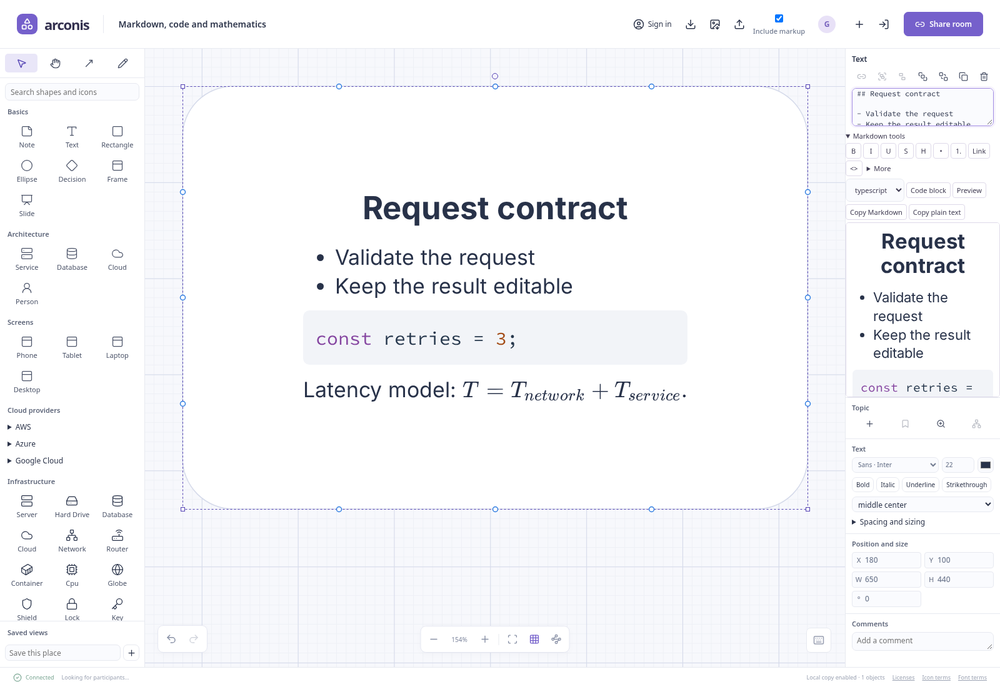

# Text, Markdown, code and equations

An object's primary label is editable Markdown source. Text controls style the whole label box;
Markdown supplies inline emphasis and structure. Subtitles are separate plain text.

Ordinary objects and sticky notes use 8 units of text padding; free text and frame headers use 4. Change padding
under **Edit text… → Spacing and sizing** when an object needs a different inset.
Padding and text sizes are style values; setting a drawing's scale does not convert them to
physical units. [Scale and measurement](editing.md#scale-units-and-measurement) applies to
distances and object geometry.

## Edit and finish text

Double-click an object or select it and press Enter to type on the canvas. Notes and free text
open ready for typing when placed. For longer writing, choose **Edit text…** in Properties or
**Open text editor** in the floating toolbar. The larger editor holds Markdown source, subtitle,
preview and typography together.

Your source changes immediately in your browser. Finish the edit by leaving the source and
its tools, pressing Escape, or pressing **Ctrl/Command Enter**. Others receive the completed
edit, and local persistence retains your work while you type. Escape keeps your text.
Enter by itself adds a line.

The selected object's toolbar changes to Markdown formatting while you edit text. **Code, preview
and copy** opens the less frequent text actions in that same container. The larger text editor
shows **Markdown tools** beside its source. **Ctrl/Command Enter** applies the current edit while
keeping that dialog open; **Done** or Escape returns to the canvas. Actions preserve the source
selection so you can apply several without restarting the edit. Undo reverses your own changes
while peers' completed edits continue to merge.



## Format content

| Content                   | Source                                              |
| ------------------------- | --------------------------------------------------- |
| Heading                   | `## Decision`                                       |
| Bold, italic, strike      | `**important**`, `_emphasis_`, `~~removed~~`        |
| Inline code               | `` `request.id` ``                                  |
| Link                      | `[Runbook](https://example.com/runbook)`            |
| Canvas object link        | `[Storage](canvas://object-id)`                     |
| Bullets and numbering     | `- item` or `1. item`, with indentation for nesting |
| Quote                     | `> observation`                                     |
| Underline                 | `<u>underlined</u>`                                 |
| Subscript and superscript | `H<sub>2</sub>O`, `x<sup>2</sup>`                   |
| Inline highlight          | `<mark>check this</mark>`                           |

The formatting toolbar inserts these source forms. **More** includes superscript, subscript,
highlighting, equations and clearing inline formatting. Supported semantic tags take no attributes.

Within lists, Enter continues the list; Enter on an empty item exits or outdents it.
Tab and Shift Tab indent and outdent list items and code. Shift Enter inserts a continuation
line in a list. Outside those contexts, topic text retains Tab to add a branch and Alt Enter
to add a sibling; see [topic trees](editing.md#topics-and-depth).

### Link to another canvas object

Select text and choose **Object** in the Markdown toolbar, then click the destination on the
canvas. This works for unnamed objects too. **Search objects** finds destinations by name, tag or
id when they are farther away; use the arrows and Enter to choose a result. Without a text
selection, insertion uses the destination's name or kind. Escape or right-click cancels picking,
and middle-drag pans while picking.
In the larger text editor, **Object** opens search directly; choose a result to insert the link.

Object links use ordinary Markdown: `[Storage](canvas://object-id)`. `local://object-id` is also
accepted. The id is case-sensitive and stays the same when the object is renamed. Link labels
remain the text you wrote. Follow a link from the canvas or Markdown preview to select its target
and move the view there. **Ctrl/Command [** returns to the previous view. A deleted destination
shows a notice instead of opening another tab.

### Text-editing shortcuts

| Keys                 | Action                   |
| -------------------- | ------------------------ |
| Ctrl/Command B       | Bold                     |
| Ctrl/Command I       | Italic                   |
| Ctrl/Command U       | Underline                |
| Ctrl/Command K       | Insert a link            |
| Ctrl/Command Shift X | Strike                   |
| Ctrl/Command Enter   | Finish the edit          |
| Escape               | Finish and keep the edit |

## Add code

Use **Markdown tools** to choose a code language and insert a code block, or type a fence:

````markdown
```typescript
const route = { from: "browser", to: "api" };
```
````

Language-labelled fences receive syntax highlighting for the bundled languages. Unlabelled or
unknown languages display as readable monospace code. **Preview** offers **Copy code** for each
code block. Code is displayed, not executed.

## Add mathematics

Write `$E = mc^2$` for inline math. For a displayed equation, use separate lines:

```markdown
$$
\sum_{i=1}^{n} i = \frac{n(n+1)}{2}
$$
```

A fenced `math` block also creates display math. **More** provides **Inline equation** and
**Display equation** actions. Math renders locally with KaTeX. If an expression is unsupported,
its error remains visible and the original source stays editable; correct the source to recover.
Escape a literal dollar sign with a backslash. Dollar signs inside code stay literal.

## Style and size the box

Select an object and choose **Edit text…**. Choose a bundled sans, serif or
monospace font, numeric size, color and whole-box emphasis. **Text position** combines horizontal
and vertical alignment. For multiple selections, mixed values are shown as mixed; changing a
control applies it to the selection.

**Spacing and sizing** contains line height, paragraph spacing, padding, text highlight and
**Fit to text**. Free text can **Grow height with text** at fixed width. Explicitly resizing its height
makes it fixed again. Fit to text changes eligible text boxes while preserving the size of
pictures, vendor icons, slides and container titles.

An ellipsis button marks clipped text on the canvas. Hover or focus it to preview the content;
click it to fit the box to its text. The original source and chosen size stay intact until you fit.
Line height is a font-size multiplier, paragraph spacing uses em, and padding uses canvas units.

Markdown headings retain their semantic hierarchy within the chosen box style. Use separate
objects when you need independently positioned text regions.

## Copy and export

- **Copy Markdown** copies exact source for another Markdown editor or an assistant.
- **Copy plain text** removes presentation syntax while retaining content, code and equation source.
- **Copy code** copies the fenced contents from Preview.
- Native documents and PNG embedded copies preserve source and box styling. PNG rendering embeds
  the required fonts, text styles, syntax highlighting and math assets.

Other Markdown applications choose their own typography. [Files and pictures](files.md) explains
the distinction between a rendered PNG and its editable canvas copy.

## Limitations

The source supports Markdown and KaTeX's LaTeX subset, with the small semantic-tag set above.
Other HTML is displayed as text. Add images as canvas picture items. Uploaded fonts and
per-character font-size or color editing are outside these controls.
